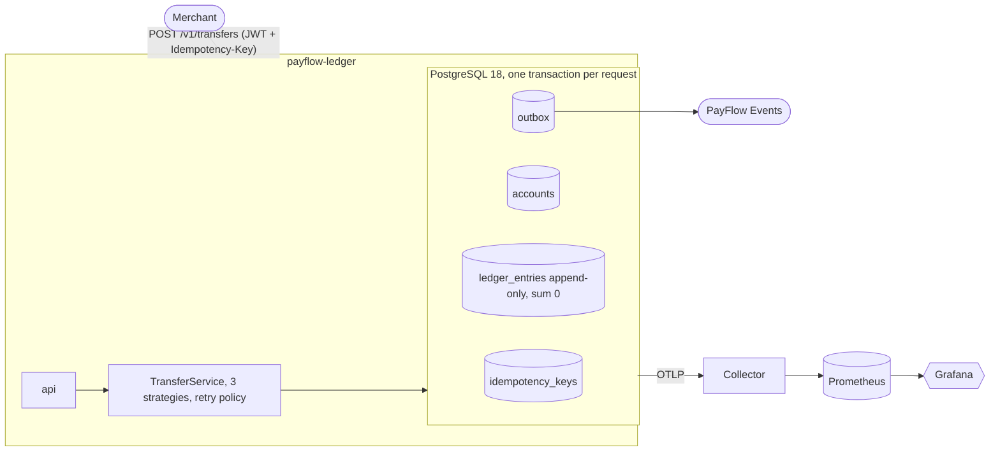

# PayFlow Ledger

Idempotent double-entry payment core. Goal: prove 0 duplicate charges, 0 ledger imbalance and 100% tamper detection under injected failure, and measure what each design choice costs.

Java 25 (virtual threads), Spring Boot 4.0, PostgreSQL 18, JdbcClient on the money path, OpenTelemetry to Prometheus/Tempo/Loki/Grafana. Plan: `docs/plan.md`. Status log with every decision and caveat: `docs/progress.md`.



## What is proven (all measured, see the logs in `docs/progress.md`)

| Claim | Result | How |
|---|---|---|
| Duplicate charges | **0**. 100 threads on one key produce exactly 1 transaction and 100 identical responses; a second charge with the same key violates a DB unique constraint | `IdempotencyRace*IT` (all strategies), chaos run |
| Ledger imbalance / negative balances / balance mismatch | **0** in every test and bench run (~20k transfers from 500 threads per strategy) | `ConcurrencyIT`, InvariantChecker gauges |
| Tamper detection | **100%**: 1,000 of 1,000 mutations (edit 334, delete 333, reorder 333) over 1,000,000 chained entries | `make tamper` |
| Chaos (short run) | 0 duplicates, 0 imbalance, 0 deadlocks after 10 kill -9 + 5% connection resets; 5,600 transfers = 5,600 keys | `make chaos` (6k requests, 1 profile) |
| Deadlocks with ordered locks | **0** | concurrency tests, chaos |
| Java and SQL hash agree | 10,000 of 10,000 random inputs | `HashChainTest` |
| Illegal payment moves | all 49 (from, to) pairs checked; illegal moves return 409 | `PaymentStateTest`, `LedgerPropertiesIT` |
| Test coverage (money packages) | 91.2% lines (gate 80%) | JaCoCo |

## Performance (laptop, 12 logical CPUs, Postgres + app + load generator on one box, plus unrelated background load)

Interleaved before/after rounds, n=2, 200 users, client-side p50/p99 and Prometheus TPS (`docs/results.md`):

| Change | Result | Decision |
|---|---|---|
| **T4: whole transfer as one SQL function** | round-trips **8 -> 1**; uniform TPS 707 -> 961 (+36%), p99 1754 -> 1188 ms (-32%); one hot account TPS 335 -> 477 (+42%), p50 538 -> 362 ms | kept |
| T2: pool 16 -> 32 | TPS 1132 -> 1246 (+10%), p50 134 -> 77 ms | kept |
| T3: platform threads | uniform p99 +44% worse | reverted |
| T7: Postgres group commit | TPS -46% | reverted |
| Verifier speed | 40k -> **175,787 entries/s** (target 100k) | kept |

Locking comparison (reduced, 6 runs): under one hot account PESSIMISTIC 317 TPS vs OPTIMISTIC 168 and SERIALIZABLE 140; on uniform traffic they are close. Details and the production rule: `docs/locking-verdict.md`. Chart: `docs/locking.png`.

## Honest gaps

- p99 is still above the 50 ms target (hundreds of ms at 200 users on this shared laptop). The 2-3x throughput target was not reached against the first baseline in a like-for-like way; the interleaved table above is the reliable comparison.
- Hot-account buckets are implemented and correct but gave **no** throughput gain in the measured setup (0.99x at N=16 vs 5x target).
- Run only partly: chaos (1 profile, 6k requests), matrix (6 of 27 runs). Not run: Docker-based stack (Tempo/Loki/Grafana verification), GitHub Actions workflows, kind deployment, release. Details in `docs/progress.md`.
- Found and fixed along the way: a virtual-thread cold-start wedge with the Spring Boot fat jar (use the extracted layout / the Jib image), OTLP metric names defaulting to milliseconds, a logback-appender version incompatible with Boot's OpenTelemetry, a tamper-generator bug.
- Plan deviation: `idempotency_keys` is not day-partitioned because Postgres would then not enforce key uniqueness across days.

## Run it

```
mvn verify                       # unit, integration, concurrency, race, property tests (needs a local Postgres 18, see PG_TEST_ADMIN_URL)
bash scripts/seed.sh             # seed template: 100 merchants x 100 accounts
bash scripts/native-prom.sh &    # Docker-less Prometheus with the OTLP receiver
bash scripts/bench.sh            # baseline runs;   python perf/report.py -> docs/results.md
bash chaos/chaos.sh              # CHAOS_REQUESTS / PROFILES to scale it
bash chaos/tamper.sh
make up                          # Docker path: app + Postgres + Toxiproxy + Collector, Prometheus, Tempo, Loki, Grafana (not verified here)
```

API: Swagger at `/swagger-ui`, examples in `api.http`, spec snapshot `docs/openapi.json`.
